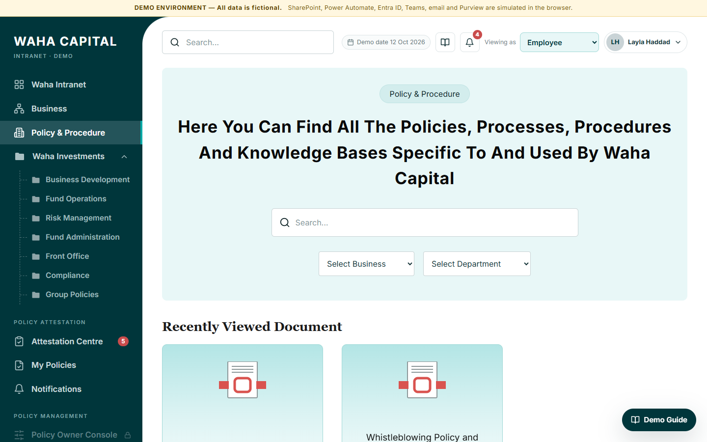

# Waha Capital — Policy Attestation Solution (Interactive Demo)

> **DEMO ENVIRONMENT — all data is fictional.** Every employee name, ID, policy, campaign, receipt and metric in this repository is invented. Nothing here is a real Waha Capital document, person or figure.

A standalone, browser-only prototype that shows how auditable policy **read-and-acknowledge** extends the existing Waha Capital SharePoint (SPFx) intranet. It follows the Policy Attestation Scope of Work prepared by ROR Technologies, and it recreates the look of the existing *Policy & Procedure* screens in plain HTML, CSS and JavaScript.

The demo needs no SharePoint tenant, backend, build step or credentials.



## Features

| Area | What you can do |
|---|---|
| **Policy & Procedure library** | Landing page with hero search and business/department filters, recently viewed documents, business and department folders, document listing with full metadata (ID, business, department, owner, approver, creation, upload, effective and review dates, version, attestation flag), and a policy document page with version history |
| **Attestation Centre** | KPIs (assigned, pending, completed, overdue, completion %), tabs (All / Pending / Completed / Overdue), due-soon list, recent activity, overdue banner |
| **Policy Reader** | Exact assigned version, reading-progress bar, *simulated* minimum reading timer (10 s by default), scroll-to-end check, confirmation statement, initials validation, then acknowledgement with a unique receipt reference |
| **Receipts** | On-screen success page, receipt with version, simulated fingerprint, server timestamp (simulated), printable |
| **Policy Owner Console** | KPIs, filterable policy register, add policy, edit metadata (validated), create new major/minor version, publish (with re-attestation prompt), configure review date, view history, workflow configuration without code, simulated Entra ID joiner/leaver, reset demo data |
| **Campaign Management** | Annual, regulatory change, policy update, exception/ad hoc and new joiner campaigns; five-step wizard (details → policies & versions → audience → schedule → review & launch); live assignment preview with duplicate detection; scheduled campaigns and "launch now" |
| **Notifications & escalation** | SOW schedule (day 0; reminders on days 5, 10 and 13; due on day 14; escalations on days 15, 21 and 28; weekly after that), notification centre, bell popover, escalation queue, **Simulate Workflow** (+1 / +7 days per campaign, or next step per item), send reminder, escalate, extend, exempt, close as acknowledged late, record non-compliance — every action is logged |
| **Reports & Dashboard** | Seven KPIs and five Chart.js charts (completion by campaign and by department, pending versus completed, overdue by department, status distribution), date/campaign/department/search filters, overdue register, CSV export |
| **Audit Evidence** | Read-only record list with search and filters (policy, campaign, status, outcome), record detail with event log, simulated Purview retention indicator, CSV export, printable evidence report |
| **Line Manager** | Team KPIs, completion by team member, overdue items, upcoming deadlines, escalation history, team-member and policy filters, simulated "nudge" |
| **Review & Expiry** | Alerts at 60, 30 and 7 days before review, overdue (lapsed) indicator, update review date, mark review completed |
| **Demo tooling** | Persona switcher, 16-step demo guide with one-click "Go" for each step, fixed demo date, LocalStorage persistence, reset with confirmation |

## Demo personas

| Persona | Fictional user | Access |
|---|---|---|
| Employee | Layla Haddad (E1001), Risk Analyst | Library, Attestation Centre, My Policies, Notifications |
| Policy Owner | Sara Mansour (E1004), Head of Compliance | Everything above, plus Console, Campaigns, Review & Expiry, Reports and Audit Evidence |
| Line Manager | Karim Nasser (E1002), Risk Manager | Employee areas plus My Team (read-only, except nudges) |
| Auditor | Daniel Clarke (E1005), Internal Audit Lead | Library, Reports (read-only) and Audit Evidence (read-only) |

Switch persona with **Viewing as** in the header or from the user menu. Navigation items a persona cannot use are shown with a lock, and their routes show an "access restricted" page.

The employee persona needs the initials **LH** to acknowledge a policy.

## Recommended demo journey (10–15 minutes)

Open **Demo Guide** (the floating button or the book icon). Each step has a **Go** button that sets the persona and opens the right screen:

1. Policy & Procedure landing → 2. Waha Investments → 3. Risk Management → 4. Enterprise Risk Management Policy → 5. switch to Employee → 6. Attestation Centre → 7. read and acknowledge a pending policy → 8. view the receipt → 9. switch to Policy Owner → 10. create and launch a campaign → 11. Reporting Dashboard → 12. updated completion metrics → 13. simulate a reminder or escalation → 14. switch to Auditor → 15. Audit Evidence and export → 16. back to the policy register.

## Run locally

There are no dependencies to install.

```bash
# Option 1: open the file directly
start index.html            # Windows  (macOS: open index.html)

# Option 2: serve the folder (recommended)
npx serve .                 # or: python -m http.server 8080
```

Then browse to the printed URL. Routing is hash-based (`#/attestation`), so the app works from `file://`, from any static server, and under a GitHub Pages sub-path.

## Reset demo data

- **User menu → Reset demo data**, or
- **Policy Owner Console → Configuration & demo administration → Reset demo data**.

Both ask for confirmation. Reset deletes this browser's LocalStorage copy and regenerates the deterministic seed: 200 employees, 35 policies, 7 departments, 6 campaigns, about 1,800 assignments, plus events and notifications.

## Technology stack

- HTML5, CSS3 (custom properties, responsive grid), vanilla JavaScript (ES2020, no framework, no build step)
- Chart.js 4.4.1 from jsDelivr; if the CDN is unreachable, charts fall back to simple bars and data tables
- Inline SVG icons adapted from Lucide (bundled; no icon CDN)
- Inter font from Google Fonts, with a system-font fallback
- LocalStorage for demo persistence
- GitHub Actions + GitHub Pages for hosting

```
index.html
css/styles.css          design tokens, layout, components, print and responsive rules
js/util.js              safe HTML templating (auto-escaping), dates, PRNG, CSV, modals, toasts, print
js/components.js        icons, badges, KPIs, pagination, charts, view/handler registry
js/data.js              deterministic fictional seed data and fictional policy text
js/storage.js           LocalStorage persistence
js/logic.js             attestation business logic: status, workflow, campaigns, versions, reviews, metrics
js/views/*.js           library, employee, owner, campaigns, insights (reports, audit, team)
js/app.js               router, shell, personas, notifications, demo guide
```

## Publishing to GitHub Pages

The workflow in `.github/workflows/pages.yml` deploys the static files on every push to `main`.

1. Push the repository to GitHub.
2. In **Settings → Pages**, set **Source** to **GitHub Actions**.
3. Wait for the *Deploy demo to GitHub Pages* workflow to finish. The site is served at `https://<owner>.github.io/<repository>/`.

## Limitations of the prototype

- **Not connected to Microsoft 365.** There is no SharePoint Online, SPFx deployment, Power Automate, Entra ID, Outlook, Teams or Microsoft Purview integration. All of these are simulated in the browser.
- **Storage is not immutable.** LocalStorage can be edited or cleared by the user. The append-only log, record locking, tamper resistance and Purview retention shown in the UI are **simulated indicators only**. They must be implemented with SharePoint list permissions and Purview record labels, and then validated, in the real tenant.
- **The reading timer is not proof of reading.** The minimum reading time is a short, clearly labelled demo timer plus a scroll check.
- **Time is simulated.** The demo date is fixed at 12 October 2026, and "Simulate workflow" moves a per-item clock instead of waiting real days.
- **Fingerprints are simulated.** The SHA-256 values are deterministic placeholders, not hashes of real PDFs.
- **Uploads are not stored.** The "new version" upload keeps only the file name.
- **Personas replace SSO.** There is no authentication.
- **Data is per browser.** Every viewer has an independent copy.

## Security and privacy

- No API keys, tokens, credentials, `.env` files or backend calls. The only network requests are for Chart.js and the web font.
- No real employee data and no real or confidential policy documents. Policy text is generated fictional sample content.
- The client's reference screenshots and the SOW PDF are **not** included in this repository. The interface is recreated in HTML/CSS.
- User-entered values are escaped before rendering, and CSV exports neutralise spreadsheet formula injection.
- The page sets `noindex` to discourage search-engine indexing.

## Confirmation

All employee names, identifiers, policies, campaigns, receipts and metrics are fictional and exist only to demonstrate the proposed solution.
